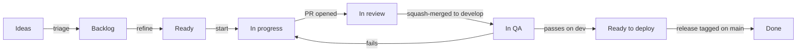

# Branching, ticket lifecycle and release

How a ticket moves from an idea to production, how code moves between branches, and how we ship and hotfix. The `/lm-*` commands in `.claude/skills/` follow this document; if the two disagree, this document wins and the command is fixed.

## 1. The parallel rule

Up to **two** tickets may be in flight at once (In progress, In review or In QA), **three** once CI runs on every PR (ticket #6). A ticket is in flight from **In progress** until **Ready to deploy**. The `product-manager` agent picks the set; `/lm-next` refuses a ticket that would exceed the limit or overlap one in flight.

Two tickets may run together only when all of this holds:

- their Areas differ, or their "Where it lands" parts of the product do not intersect;
- neither blocks the other;
- they do not both change a migration chain, the lockfile, the OpenAPI contract or shared config.

Each ticket has its own branch. The ticket being built is checked out in the owner's checkout, so the owner sees the changes in the editor and can work on them too; any other ticket in flight uses its own git worktree (`../lm-<n>`), so two tickets never share a working tree. The `lm-next` skill has the switching rules (clean tree only, back to `develop` after the merge).

If a ticket in flight turns out to depend on another one, `/lm-next block <blocker>` marks the ticket on the current branch as blocked by it and sends it back to Ready. The blocker is ordered first. A blocker counts as resolved at Ready to deploy.

A production hotfix (section 8) may exceed the limit. So may an owner-run ticket with no repository code (an account, a recording, a vendor request), labelled `owner-task`: it runs outside the limit, one at a time, except that one which is only waiting on a third party (a registration, a vendor reply) doesn't count, and needs no branch or worktree.

Why: a small parallel set keeps `develop` releasable, review load bounded and context small enough for one session each, while tickets that cannot conflict no longer wait for each other.



## 2. Board columns

Board: org project #6, "GaugePrep Delivery", in the `Frank-Tech-Org` organisation; repository `Frank-Tech-Org/GaugePrep`. Both were renamed on 2026-11-04 with the product (D-10); the old names redirect.

| Column | Meaning | Where the code is | Leaves when | Command |
|---|---|---|---|---|
| **Ideas** | Raw, untriaged ticket or suggestion | Nothing | Accepted into the backlog, or closed as duplicate or won't do | `/pm plan` |
| **Backlog** | Accepted: type, area, priority and milestone set, not yet refined | Nothing | Refined | `/pm plan` |
| **Ready** | Refined: acceptance criteria, Definition of Done and dependencies written, sized to two days or less | Nothing | Picked as the next ticket | `/pm`, `/lm-next` |
| **In progress** | Being built (in flight) | `feature/<n>-<slug>` | PR opened into `develop` | `/lm-next` |
| **In review** | PR open (in flight) | PR into `develop` | Approved and squash-merged | `/lm-next` |
| **In QA** | Merged, deployed to dev (in flight) | `develop`, dev | QA passes, or fails back to In progress | `/lm-next` |
| **Ready to deploy** | Passed QA; no longer in flight | `develop`, then `stage` and staging once promoted | Included in a tagged release | `/lm-release` |
| **Done** | Live, tagged, "Released in" posted, issue closed | `main` | — | — |

A blocked ticket goes back to **Ready** with the `blocked` label and a GitHub "blocked by" link to its blocker. A blocker counts as resolved once it reaches Ready to deploy.

## 3. Branches and environments

Three long-lived branches, each deployed to its own environment. Code only moves forward: `develop` to `stage` to `main`. A hotfix is the one change that starts on `main`, and it is merged back.

| Branch | Purpose | Merged into it by | Deployed to |
|---|---|---|---|
| `main` | Production. Every commit on it is a tagged release. | Owner, merge commit, from `stage` or `hotfix/*` | Production (on a version tag) |
| `stage` | The release candidate: what is about to ship. | Owner, merge commit, from `develop` (promotion) or `main` (hotfix back-merge) | Staging (on push) |
| `develop` | Integration branch and the repository default. Holds QA-passed work plus the tickets in QA. | `/lm-next` via `merge.sh`, squash, from `feature/*` or `chore/*` (the owner for PRs that touch the guard hook, settings, CI workflows, the git hooks or any helper script); owner, merge commit, from `main` after a hotfix | Dev (on push) |
| `feature/<n>-<slug>` | One ticket of any type except a production hotfix | — | — |
| `chore/<slug>` | Repository and workflow housekeeping, and the changelog commit of a release | — | — |
| `hotfix/<version>-<slug>` | Urgent production fix, branched from `main` | — | Staging (manual run) |

Short-lived branches are deleted after merging. Promotions use merge commits, never squash, so `stage` and `main` keep the same commits as `develop` and never drift.

| Environment | Runs | For | Data and keys |
|---|---|---|---|
| Local | The owner's checkout or a ticket's worktree, Docker Compose | Building and the checks before a PR | Seed data, local open models, test keys |
| CI | Every PR, thrown away after | Tests and security scans | None |
| Dev | `develop`, the shared dev and staging server, own Neon branch, Doppler `gaugeprep/dev` | QA of each ticket | Synthetic seed data; fake SMS, self-hosted open models for AI and speech, test payment keys |
| Staging | `stage`, the same server as a separate deploy, own Neon branch, Doppler `gaugeprep/stg` | Release gate (attack tests, load test, 3G checks), regression and the Friday demo | Synthetic seed data; free or test-mode providers, self-hosted open models for AI and speech, no paid service |
| Production | `main` at a tag, Hetzner | Learners | Real data, live keys |

Why `stage` exists: the Friday demo and the release gate need a version that doesn't change while agents keep merging into `develop`. It replaces the `release/*` branches; a fix found on staging is made on `develop` and promoted again, so nothing is cherry-picked or back-merged after a normal release.

## 4. Versioning

[Semantic Versioning](https://semver.org/): `MAJOR.MINOR.PATCH`, tagged on `main` with an annotated tag such as `v0.3.0`.

| Bump | When | Comes from |
|---|---|---|
| MINOR | New capability (any release with a feature) | `stage` |
| PATCH | Fixes only | `hotfix/*`, or a release from `stage` with only fixes |
| MAJOR | Breaking API change (`/api/v2`) or a non-reversible migration | `stage` |

Versions stay at `0.x.y` until the PRD's release 1 goes live, which is tagged `v1.0.0`.

## 5. Names, commits and PRs

```
feature/<issue>-<short-slug>        feature/7-django-skeleton
chore/release-<version>             chore/release-0.2.0
hotfix/<version>-<short-slug>       hotfix/0.2.1-fix-timer-drift
```

- **Commit and PR titles** follow Conventional Commits, as commitlint enforces: `feat(api): add the health endpoint`. The squash merge keeps the PR title as the commit subject.
- **Linking.** The ticket's branch is created from the ticket (`gh issue develop <n> --name feature/<n>-<slug>`), so the branch and its PR show in the ticket's Development panel. The PR body also says `Refs #<n>`, never `Closes #<n>`. A PR linked this way closes the issue when it merges into `develop`, the default branch, so the board's Status, not open or closed, says where a ticket is. A failed QA reopens it, and the release posts "Released in" on every shipped ticket.
- **No repository change, no PR.** A ticket that writes nothing into the repository (an owner task, research, a decision recorded only on the ticket) has no branch and no PR; its result goes on the ticket.
- **Traceability.** `merge.sh` writes the PR body's `Refs #<n>` lines into the squash commit, so `git log --grep "#<n>"` finds every change of a ticket, including its fix PRs.
- Agents commit to the ticket's branch, push it and open the PR. The merge step of `/lm-next` merges reviewed PRs into `develop`; only the owner merges into `stage` and `main`, pushes tags and publishes releases. Nobody pushes straight to `main`, `stage` or `develop`.

## 6. Ticket workflow

In a normal week the owner runs two commands: `/pm` to plan and `/lm-next` to move work. Commands take no ticket number. Each works out its target from the board, the current branch or worktree, open PRs and the last checkpoint, checks that the environment allows the step, and otherwise names the command to run instead. `#n` overrides the choice.

1. **Triage.** New tickets land in Ideas. `/pm plan` sets type, area, priority and milestone, flags duplicates, and moves accepted tickets to Backlog. The owner closes duplicates and rejected ideas.
2. **Refine.** The same `/pm plan` pass writes the acceptance criteria, the Definition of Done, where it lands and the dependencies, splits anything over two days, and moves the ticket to Ready.
3. **Plan the sprint.** It then puts Ready tickets into the two-week Sprint iteration in dependency order. Sprints sit inside the product milestones (M0 to M8).
4. **Pick.** The `cto` agent writes the technical read, and `/pm` hands it to `product-manager`, which names the set of tickets to start, up to the parallel limit: blockers first, then milestone, priority and size, and only tickets that cannot conflict.
5. **Build.** `/lm-next` checks the parallel limit and overlap, moves the ticket to In progress and creates `feature/<n>-<slug>` from the ticket, off an up-to-date `develop`, in the owner's checkout (or its own worktree when that holds another ticket in flight). The owning agents implement, test, commit, push the branch and open the PR into `develop`.
6. **Review.** Its next run moves the ticket to In review, and `code-reviewer` and any specialist reviewers read the diff and post their verdict on the PR. Fixes happen on the same branch.
7. **Merge.** Once the review passes and CI is green, `/lm-next` asks the owner to approve the PR on GitHub. The approval is a sign-off, not a second review: the agents have already reviewed and tested it. The next `/lm-next` runs `.claude/scripts/merge.sh <pr>`. It squash-merges into `develop` and deletes the branch, and refuses unless the base is `develop`, the branch is `feature/*` or `chore/*`, every check is green, the latest `REVIEW: PASS` names the PR's head sha, and the owner's latest approval is for that same sha. A push after the approval makes it stale. The owner can still merge by hand.
8. **QA.** Dev deploys from `develop`. After the merge, `/lm-next` moves the ticket to In QA and checks every acceptance criterion on dev. A pass moves it to Ready to deploy. A fail sends it back to In progress with the defects listed and reopens the issue if its merge closed it; the fix goes on `feature/<n>-<slug>-fix`, created from the ticket with `gh issue develop`, in a new PR that references the same ticket.

Until dev exists (M0 ticket #11), QA runs against a local build of `develop`, and the QA report says so.

## 7. Release workflow

**When to release.** A release is due when any of these holds, and `/pm` says so:

- a key feature of release 1 is complete: every ticket that serves it is Ready to deploy (MINOR);
- the end of a sprint, with fixes Ready to deploy and no feature complete (PATCH);
- M0 is complete: the first release, `v0.1.0`, proves the pipeline end to end before any feature ships.

A hotfix never waits (section 8). Ready to deploy tickets that belong to an unfinished feature ship with the next release; a screen a learner could reach half-built stays unlinked until its feature is complete.

**Which version.** The last tag plus one: MINOR if any released ticket is a Story or Task that adds a capability, else PATCH (section 4). `/lm-release` works it out; a version given by the owner overrides it.

`/lm-release` drives it; `/lm-release check` runs the gate alone. The release manager (`platform-engineer`, run by `/lm-release`) prepares every step; the owner presses the two buttons: promote to staging and ship to production.

1. Confirm no ticket is In QA, so `develop` holds only QA-passed work, and list the Ready to deploy tickets. Tickets in progress or review may continue; they are not on `develop` yet. A ticket that failed QA has code on `develop` but is back In progress: wait for its fix, or revert its squash commits (`git log --grep "#<n>"`) on a `chore/revert-<n>` PR before promoting. The ticket returns to Ready, and its work comes back in a new PR. Never cherry-pick a subset of `develop` into `stage`: migrations and the generated API client depend on the commits before them.
2. The release manager commits the `CHANGELOG.md` entry on `chore/release-<version>`, and `/lm-next` merges it into `develop` like any reviewed PR.
3. The release manager opens the promotion PR from `develop` into `stage`. The owner merges it with a **merge commit**. Staging deploys.
4. On staging, run the gate (security pass and attack test, dependency audit, performance audit with the load run, claim verification, UX check on changed screens) and `qa-engineer`'s regression. A failure is fixed by a ticket on `develop`, then promoted again from step 3.
5. The release manager opens the release PR from `stage` into `main` using the release PR template. `content-marketer` writes the French and English release notes, starting from GitHub's generated notes (`gh api repos/Frank-Tech-Org/GaugePrep/releases/generate-notes -f tag_name=v<version> -f target_commitish=stage -f previous_tag_name=<last tag>`, which creates nothing) and rewriting them in learner terms. The owner merges the release PR with a **merge commit**.
6. The owner tags and publishes:
   ```bash
   git switch main && git pull
   git tag -a v0.2.0 -m "Release v0.2.0"
   git push origin v0.2.0
   gh release create v0.2.0 --notes-file release-notes.md
   ```
   The tag triggers the production deploy (M0 ticket #13).
7. `/lm-release 0.2.0 done` moves the included tickets to Done, posts "Released in" on each and closes any still open. No back-merge is needed: everything on `main` came from `develop`.

## 8. Hotfix workflow

For an urgent production bug: a Bug ticket with priority Urgent and the `hotfix` label. It is the one thing allowed to exceed the parallel limit. `/lm-hotfix` posts a checkpoint on each ticket in flight, then works the fix.

1. Branch from `main`, never from `develop` or `stage`, so unreleased work cannot reach production:
   ```bash
   gh issue develop <n> -R Frank-Tech-Org/GaugePrep --base main --name hotfix/0.2.1-fix-timer-drift
   git fetch origin hotfix/0.2.1-fix-timer-drift
   git switch hotfix/0.2.1-fix-timer-drift
   ```
2. The agents fix, test, commit, push and open a PR into `main`. Run the staging deploy workflow on the hotfix branch and QA it there.
3. The owner merges with a merge commit, tags `v0.2.1`, pushes the tag and creates the GitHub release.
4. Back-merge `main` into `stage`, then into `develop`, through PRs the release manager opens and the owner merges with merge commits. Skipping this brings the bug back in the next release. The next push to `stage` redeploys staging from `stage`.
5. Move the ticket to Done, then resume the interrupted ticket from its checkpoint.

## 9. Branch protection

| Branch | Target rules |
|---|---|
| `main` | PR required, CI green, no direct pushes, only PRs from `stage` and `hotfix/*` |
| `stage` | PR required, CI green, no direct pushes, only PRs from `develop` and `main` |
| `develop` | PR required, CI green, owner's approval, squash merge only (merge commit for a back-merge from `main`); the develop alarm checks it after the fact |

Status: the helper-script, alias and `bash -c` guard rules, the wider edit denials and the develop alarm are staged in `.claude/proposed/` and take effect when the owner runs the installer there. Until then `develop` has the older guard and no develop alarm. Delete this paragraph once the installer has run and its files are merged.

GitHub doesn't enforce these on the free plan for a private organisation repository: the API returns 403, and we stay on the free plan. The protection is built from parts:

- Agents are held by the deny list in `.claude/settings.json` and the guard hook: no raw push, `gh pr merge`, tag, release, `--amend` or `reset --hard`. They push only with `.claude/scripts/push.sh`, and `/lm-next` merges only with `.claude/scripts/merge.sh`.
- A write-access account can still change `main` or `stage`. A workflow on every push to `main` alerts the owner when the commit did not come from an allowed PR. The production deploy runs only from a tag, and the workflow checks that the owner pushed it, so a bad change on `main` cannot reach users.
- A second workflow, the develop alarm, does the same for `develop` and `stage`. A push opens an issue assigned to the owner unless the commit is the merge commit of a merged PR. Allowed into `develop`: from `feature/*` or `chore/*`, merged by the owner or carrying the owner's approval of the PR's last commit (what `merge.sh` requires), and from `main`, merged by the owner. Allowed into `stage`: from `develop` or `main`, merged by the owner. A forced push, a deleted branch, and any commit that changes a workflow file without the owner's merge always raise it. `[skip ci]` can skip the push run, so a scheduled run every hour rechecks the last two hours of pushes (taken from GitHub's push log, not commit dates) and scheduled runs ignore `[skip ci]`. It opens one issue per commit, even if the issue was closed. To prove it fires, run it by hand with a commit that is not a merged PR: `gh workflow run develop-alarm.yml -f branch=develop -f sha=<commit>`. The agents' token lacks the workflow scope, so GitHub refuses a push that edits or deletes the alarm file. It detects; it does not block.
- Two accounts, both organisation owners. Agents work as `KefouegFrank`, the owner's main account, so the commits count on it. The owner approves as `frankkefoueg`, the only account used for `stage`, `main`, tags and releases. GitHub won't let the account that opened a PR approve it, so the approval on a `develop` PR always comes from the other account, and `merge.sh` checks it.
- Because the agents' account is an owner, its only GitHub-side limit is its token: on the agents' machine it is logged in to `gh` with a token. Today that is a classic token with the scopes `gist`, `project`, `read:org` and `repo`; the fine-grained token below is the target.

Setting up the agents' account:

1. In the organisation's Settings → Personal access tokens, fine-grained tokens are allowed (approval required is fine).
2. Signed in as that account, create a fine-grained token: resource owner `Frank-Tech-Org`, only `GaugePrep`, 90 days. Read and write: Contents, Pull requests, Issues. Read: Metadata, Actions, Commit statuses (fine-grained tokens can't have Checks, so tools read CI from Actions runs). Leave Workflows out, so the account can't push workflow changes. Organisation permission Projects: read and write.
3. Approve the token request as organisation owner if GitHub asks.
4. On the machine running the agents: `gh auth logout -u <account>` for any broader login of that account, then `gh auth login --with-token` (paste the token), `gh auth setup-git` and `gh auth status`. The owner account `frankkefoueg` is never logged in to `gh` on this machine: the owner approves, merges into `stage` or `main`, tags and releases in the browser or as another OS user.

Files that control these limits change only by the owner's hand: the guard hook and the other hooks, `.claude/settings*`, every script in `.claude/scripts/` (`push.sh`, `merge.sh`, `board.sh`, `env-check.sh`), the git hooks in `.husky/`, and `.github/workflows/`. The agents' edit tools are denied on them, the guard refuses shell writes to them, and `merge.sh` refuses a PR that touches them, so the owner merges it. A script the agents run without a prompt must not be one they can edit, or a push could be hidden inside it.

The guard is a speed bump; the develop alarm is the net. It reads through `bash -c`, `sh -c`, `eval`, `env`, `sudo`, `timeout`, `xargs`, `find -exec`, `$(...)`, newline-separated commands, a full path to `git`, git aliases and `git -c` settings that can run commands. It refuses:

- git options and environment variables that name a program to run, including abbreviated ones such as `--exe=`, and exported editor, pager and `GIT_*` variables
- text piped or fed into a shell, function and `trap` bodies, `git-*` programs, `git subtree`, and `uv run`, `pnpm exec` or `doppler run` wrapping git
- GitHub calls that read a query from a file, switch workflows off, change repository settings or send a GraphQL mutation, and `curl` or `wget` writes to GitHub, including combined flags such as `-sXPUT`
- `git credential`, `gh auth` printing a token, writes under `~/.config/gh`, any `secret-tool` or keyring access, `cd` it cannot follow, and writes over a whole folder that holds owner-only files

The guard is a tripwire against ordinary and accidental pushes, not a sandbox, and the alarm is the backstop. Accepted gaps:

- a script, test file or package script the agents write and then run goes unprompted, as does a `core.hooksPath` in the owner's global git config
- split-string tricks such as `$(echo git) push`, python-built command strings and a helper path assembled from pieces
- wrappers such as `strace`, `unbuffer`, `parallel` and `make -f -`
- `gh repo sync --force` from a fork; the alarm still flags the commit
- `gh run cancel` on an alarm run; the hourly recheck covers it
- `gh variable delete` and `gh secret delete`
- uppercase API paths; GitHub answers them with a 404, so they do nothing
- reading the `gh` hosts file

The owner account is not logged in to `gh` on the machine running the agents, so nothing there holds its login. The refusals on `~/.config/gh` and the keyring stay as the guard against someone logging it back in. Step 4 above says the same.

Open gap: the agents' account token is broader than needed until the owner replaces it with a fine-grained token limited to this repository; any shell past the guard could use it for repository-admin calls.

## Weekly demo and scorecards

Every Friday the owner tries the app on staging, on their phone and on a computer, and reads two scorecards:

- **Security:** serious issues open (target zero) from the CI scans and the weekly staging scan, and the date of the last attack test.
- **Performance:** each PRD budget against the latest Lighthouse and k6 figures.

On Thursday `/pm report` has `product-manager` post one entry in the Notion database **Weekly demos** (under the owner's private studio page): the 13 key features of release 1 delivered against those still to deliver, in learner terms with no ticket numbers, then launch readiness, the two scorecards and risks to the launch date. `security-engineer` and `performance-engineer` supply the scorecards.

## 10. Checklists

**Before opening a PR**
- [ ] Branch is `feature/<n>-<slug>` created from the ticket off current `develop` (or `hotfix/*` off `main`), so it shows in the ticket's Development panel
- [ ] PR title follows Conventional Commits; body says `Refs #<n>`
- [ ] Tests and checks pass locally
- [ ] Every acceptance criterion addressed, or listed as a follow-up
- [ ] The Definition of Done items in the ticket are ticked

**Cutting a release**
- [ ] Nothing In QA; Ready to deploy list confirmed; any failed-QA ticket on `develop` fixed or reverted
- [ ] Changelog merged into `develop`; `develop` promoted to `stage` with a merge commit
- [ ] Gate passed on staging: security, dependencies, performance, claims, UX; regression QA passed
- [ ] `stage` merged to `main` with a merge commit, tagged, GitHub release created
- [ ] Tickets moved to Done and closed

**Hotfix**
- [ ] Branched from `main`; QA passed on staging
- [ ] Tagged with a PATCH version
- [ ] `main` merged back into `stage`, then `develop`
- [ ] Interrupted ticket resumed

## 11. Troubleshooting

**QA fails after the merge.** The ticket goes back to In progress and stays in flight. Fix it on a new branch from `develop`, with `Refs #<n>` in the PR. If the ticket is abandoned, or a release can't wait for the fix, revert its squash commits on `develop` before the next promotion (section 7, step 1), so `develop` stays releasable.

**One ticket, several PRs.** Normal: a fix PR or a split ticket. Each squash commit carries `Refs #<n>`, so `git log --grep "#<n>"` lists them all; a revert takes all of them, newest first.

**Reverts keep happening.** If tickets are often held back at release, ship unfinished work behind a feature switch that is off on staging and production, instead of reverting. Until then, a screen a learner could reach half-built stays unlinked (section 7).

**A defect found on staging.** Never fix it on `stage`. Fix it on `develop` through a ticket, then promote again.

**A bad change reached `main`.** Revert it instead of rewriting history (`git revert -m 1 <merge-sha>` for a merge commit), then ship a PATCH release.

**A hotfix wasn't back-merged.** Merge `main` into `stage`, then into `develop`, as soon as it's noticed. Git skips the changes that are already there.

**A ticket is stuck waiting on something outside the team** (a provider, a signed form). Mark it blocked by a Chore that tracks the outside dependency. That sends it back to Ready, and the next ticket can start.
