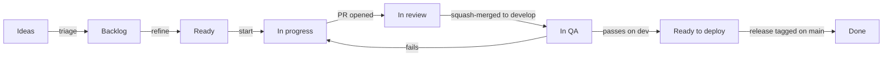

# Branching, ticket lifecycle and release

How a ticket moves from an idea to production, how code moves between branches, and how we ship and hotfix. The `/lm-*` commands in `.claude/skills/` follow this document; if the two disagree, this document wins and the command is fixed.

## 1. The parallel rule

Up to **two** tickets may be in flight at once (In progress, In review or In QA), **three** once CI runs on every PR (ticket #6). A ticket is in flight from **In progress** until **Ready to deploy**. The `product-manager` agent picks the set; `/lm-next` refuses a ticket that would exceed the limit or overlap one in flight.

Two tickets may run together only when all of this holds:

- their Areas differ, or their "Files and paths" do not intersect;
- neither blocks the other;
- they do not both change a migration chain, the lockfile, the OpenAPI contract or shared config.

Each ticket has its own branch and its own git worktree (`../lm-<n>`), so sessions never share a working tree.

If a ticket in flight turns out to depend on another one, `/lm-next block <blocker>` marks the ticket on the current branch as blocked by it and sends it back to Ready. The blocker is ordered first. A blocker counts as resolved at Ready to deploy.

A production hotfix (section 8) may exceed the limit. So may an owner-run ticket with no repository code (an account, a recording, a vendor request), labelled `owner-task`: it runs outside the limit, one at a time, and needs no branch or worktree.

Why: a small parallel set keeps `develop` releasable, review load bounded and context small enough for one session each, while tickets that cannot conflict no longer wait for each other.



## 2. Board columns

Board: org project #6, "LinguaMentor Delivery".

| Column | Meaning | Where the code is | Leaves when | Command |
|---|---|---|---|---|
| **Ideas** | Raw, untriaged ticket or suggestion | Nothing | Accepted into the backlog, or closed as duplicate or won't do | `/pm plan` |
| **Backlog** | Accepted: type, area, priority and milestone set, not yet refined | Nothing | Refined | `/pm plan` |
| **Ready** | Refined: acceptance criteria, Definition of Done and dependencies written, sized to two days or less | Nothing | Picked as the next ticket | `/pm`, `/lm-next` |
| **In progress** | Being built (in flight) | `feature/<n>-<slug>` | PR opened into `develop` | `/lm-next` |
| **In review** | PR open (in flight) | PR into `develop` | Approved and squash-merged | `/lm-next` |
| **In QA** | Merged, deployed to dev (in flight) | `develop`, dev | QA passes, or fails back to In progress | `/lm-next` |
| **Ready to deploy** | Passed QA; no longer in flight | `develop`, then `stage` and staging once promoted | Included in a tagged release | `/lm-release` |
| **Done** | Live, tagged, issue closed | `main` | — | — |

A blocked ticket goes back to **Ready** with the `blocked` label and a GitHub "blocked by" link to its blocker. A blocker counts as resolved once it reaches Ready to deploy.

## 3. Branches and environments

Three long-lived branches, each deployed to its own environment. Code only moves forward: `develop` to `stage` to `main`. A hotfix is the one change that starts on `main`, and it is merged back.

| Branch | Purpose | Merged into it by | Deployed to |
|---|---|---|---|
| `main` | Production. Every commit on it is a tagged release. | Owner, merge commit, from `stage` or `hotfix/*` | Production (on a version tag) |
| `stage` | The release candidate: what is about to ship. | Owner, merge commit, from `develop` (promotion) or `main` (hotfix back-merge) | Staging (on push) |
| `develop` | Integration branch and the repository default. Holds QA-passed work plus the tickets in QA. | `/lm-next` via `merge.sh`, squash, from `feature/*` or `chore/*` (the owner for PRs that touch the guard hook, settings, CI workflows or the push and merge scripts); owner, merge commit, from `main` after a hotfix | Dev (on push) |
| `feature/<n>-<slug>` | One ticket of any type except a production hotfix | — | — |
| `chore/<slug>` | Repository and workflow housekeeping, and the changelog commit of a release | — | — |
| `hotfix/<version>-<slug>` | Urgent production fix, branched from `main` | — | Staging (manual run) |

Short-lived branches are deleted after merging. Promotions use merge commits, never squash, so `stage` and `main` keep the same commits as `develop` and never drift.

| Environment | Runs | For | Data and keys |
|---|---|---|---|
| Local | Each ticket's worktree, Docker Compose | Building and the checks before a PR | Seed data, local open models, test keys |
| CI | Every PR, thrown away after | Tests and security scans | None |
| Dev | `develop`, Oracle Always Free server, own Neon branch | QA of each ticket | Synthetic seed data; fake SMS, cheapest AI model, test payment keys |
| Staging | `stage`, the same Oracle server as a separate deploy, own Neon branch | Release gate (attack tests, load test, 3G checks), regression and the Friday demo | Synthetic seed data; the production providers in test mode, small AI budget |
| Production | `main` at a tag, Hetzner | Learners | Real data, live keys |

Why `stage` exists: the Friday demo and the release gate need a version that doesn't change while agents keep merging into `develop`. It replaces the `release/*` branches; a fix found on staging is made on `develop` and promoted again, so nothing is cherry-picked or back-merged after a normal release.

## 4. Versioning

[Semantic Versioning](https://semver.org/): `MAJOR.MINOR.PATCH`, tagged on `main` with an annotated tag such as `v0.3.0`.

| Bump | When | Comes from |
|---|---|---|
| MINOR | New capability (any release with a feature) | `stage` |
| PATCH | Fixes only | `hotfix/*`, or a release from `stage` with only fixes |
| MAJOR | Breaking API change (`/api/v2`) or a non-reversible migration | `stage` |

Versions stay at `0.x.y` until the PRD's release 1 goes live, which is tagged `v1.0.0`.

## 5. Names, commits and PRs

```
feature/<issue>-<short-slug>        feature/7-django-skeleton
chore/release-<version>             chore/release-0.2.0
hotfix/<version>-<short-slug>       hotfix/0.2.1-fix-timer-drift
```

- **Commit and PR titles** follow Conventional Commits, as commitlint enforces: `feat(api): add the health endpoint`. The squash merge keeps the PR title as the commit subject.
- **PR body** links the ticket with `Refs #<n>`, never `Closes #<n>`. `develop` is the default branch, so `Closes` would close the issue at merge, before QA. Issues are closed at release.
- Agents commit to the ticket's branch, push it and open the PR. The merge step of `/lm-next` merges reviewed PRs into `develop`; only the owner merges into `stage` and `main`, pushes tags and publishes releases. Nobody pushes straight to `main`, `stage` or `develop`.

## 6. Ticket workflow

In a normal week the owner runs two commands: `/pm` to plan and `/lm-next` to move work. Commands take no ticket number. Each works out its target from the board, the current branch or worktree, open PRs and the last checkpoint, checks that the environment allows the step, and otherwise names the command to run instead. `#n` overrides the choice.

1. **Triage.** New tickets land in Ideas. `/pm plan` sets type, area, priority and milestone, flags duplicates, and moves accepted tickets to Backlog. The owner closes duplicates and rejected ideas.
2. **Refine.** The same `/pm plan` pass writes the acceptance criteria, the Definition of Done, the files and paths and the dependencies, splits anything over two days, and moves the ticket to Ready.
3. **Plan the sprint.** It then puts Ready tickets into the two-week Sprint iteration in dependency order. Sprints sit inside the product milestones (M0 to M8).
4. **Pick.** The `cto` agent writes the technical read, and `/pm` hands it to `product-manager`, which names the set of tickets to start, up to the parallel limit: blockers first, then milestone, priority and size, and only tickets that cannot conflict.
5. **Build.** `/lm-next` checks the parallel limit and overlap, moves the ticket to In progress and creates `feature/<n>-<slug>` in its own worktree from an up-to-date `develop`. The owning agents implement, test, commit, push the branch and open the PR into `develop`.
6. **Review.** Its next run moves the ticket to In review, and `code-reviewer` and any specialist reviewers read the diff and post their verdict on the PR. Fixes happen on the same branch.
7. **Merge.** Once the review passes and CI is green, `/lm-next` runs `.claude/scripts/merge.sh <pr>`. It squash-merges into `develop` and deletes the branch, and refuses unless the base is `develop`, the branch is `feature/*` or `chore/*`, every check is green, and the latest `REVIEW: PASS` names the PR's head sha. The owner can still merge by hand.
8. **QA.** Dev deploys from `develop`. After the merge, `/lm-next` moves the ticket to In QA and checks every acceptance criterion on dev. A pass moves it to Ready to deploy. A fail sends it back to In progress with the defects listed; the fix goes in a new PR from `develop` that references the same ticket.

Until dev exists (M0 ticket #11), QA runs against a local build of `develop`, and the QA report says so.

## 7. Release workflow

**When to release.** A release is due when any of these holds, and `/pm` says so:

- a key feature of release 1 is complete: every ticket that serves it is Ready to deploy (MINOR);
- the end of a sprint, with fixes Ready to deploy and no feature complete (PATCH);
- M0 is complete: the first release, `v0.1.0`, proves the pipeline end to end before any feature ships.

A hotfix never waits (section 8). Ready to deploy tickets that belong to an unfinished feature ship with the next release; a screen a learner could reach half-built stays unlinked until its feature is complete.

**Which version.** The last tag plus one: MINOR if any released ticket is a Story or Task that adds a capability, else PATCH (section 4). `/lm-release` works it out; a version given by the owner overrides it.

`/lm-release` drives it; `/lm-release check` runs the gate alone. The release manager (`platform-engineer`, run by `/lm-release`) prepares every step; the owner presses the two buttons: promote to staging and ship to production.

1. Confirm no ticket is In QA, so `develop` holds only QA-passed work, and list the Ready to deploy tickets. Tickets in progress or review may continue; they are not on `develop` yet.
2. The release manager commits the `CHANGELOG.md` entry on `chore/release-<version>`, and `/lm-next` merges it into `develop` like any reviewed PR.
3. The release manager opens the promotion PR from `develop` into `stage`. The owner merges it with a **merge commit**. Staging deploys.
4. On staging, run the gate (security pass and attack test, dependency audit, performance audit with the load run, claim verification, UX check on changed screens) and `qa-engineer`'s regression. A failure is fixed by a ticket on `develop`, then promoted again from step 3.
5. The release manager opens the release PR from `stage` into `main` using the release PR template. The owner merges it with a **merge commit**.
6. The owner tags and publishes:
   ```bash
   git switch main && git pull
   git tag -a v0.2.0 -m "Release v0.2.0"
   git push origin v0.2.0
   gh release create v0.2.0 --notes-file release-notes.md
   ```
   The tag triggers the production deploy (M0 ticket #13).
7. `/lm-release 0.2.0 done` moves the included tickets to Done and closes their issues. No back-merge is needed: everything on `main` came from `develop`.

## 8. Hotfix workflow

For an urgent production bug: a Bug ticket with priority Urgent and the `hotfix` label. It is the one thing allowed to exceed the parallel limit. `/lm-hotfix` posts a checkpoint on each ticket in flight, then works the fix.

1. Branch from `main`, never from `develop` or `stage`, so unreleased work cannot reach production:
   ```bash
   git switch main && git pull
   git switch -c hotfix/0.2.1-fix-timer-drift
   ```
2. The agents fix, test, commit, push and open a PR into `main`. Run the staging deploy workflow on the hotfix branch and QA it there.
3. The owner merges with a merge commit, tags `v0.2.1`, pushes the tag and creates the GitHub release.
4. Back-merge `main` into `stage`, then into `develop`, through PRs the release manager opens and the owner merges with merge commits. Skipping this brings the bug back in the next release. The next push to `stage` redeploys staging from `stage`.
5. Move the ticket to Done, then resume the interrupted ticket from its checkpoint.

## 9. Branch protection

| Branch | Target rules |
|---|---|
| `main` | PR required, CI green, no direct pushes, only PRs from `stage` and `hotfix/*` |
| `stage` | PR required, CI green, no direct pushes, only PRs from `develop` and `main` |
| `develop` | PR required, CI green, squash merge only (merge commit for a back-merge from `main`) |

GitHub doesn't enforce these on the free plan for a private organisation repository: the API returns 403, and we stay on the free plan. The protection is built from parts:

- Agents are held by the deny list in `.claude/settings.json` and the guard hook: no raw push, `gh pr merge`, tag, release, `--amend` or `reset --hard`. They push only with `.claude/scripts/push.sh`, and `/lm-next` merges only with `.claude/scripts/merge.sh`.
- A write-access account can still change `main` or `stage`. A workflow on every push to either alerts the owner when the commit did not come from an allowed PR. The production deploy runs only from a tag, and the workflow checks that the owner pushed it, so a bad change on `main` cannot reach users.
- Agents use a separate free bot account. The owner's account is the only one used for `stage`, `main`, tags and releases.

Setting up the agent account (an existing free account that is already an organisation member):

1. In the organisation's People page its role is **Member**, not Owner. The organisation's base permission is **Read** or **No permission**. In the repo's Settings → Collaborators and teams it has **Write**.
2. In the organisation's Settings → Personal access tokens, fine-grained tokens are allowed (approval required is fine).
3. Signed in as that account, create a fine-grained token: resource owner `LinguaMentor`, only `linguamentor-v3`, 90 days. Read and write: Contents, Pull requests, Issues. Read: Metadata, Actions, Commit statuses (fine-grained tokens can't have Checks, so tools read CI from Actions runs). Leave Workflows out, so the account can't push workflow changes. Organisation permission Projects: read and write.
4. Approve the token request as organisation owner if GitHub asks.
5. On the machine running the agents: `gh auth login --with-token` (paste the token), then `gh auth setup-git` and `gh auth status`. The owner returns to their own account with `gh auth switch` before merging into `stage` or `main`, tagging or releasing.

Files that control these limits (`.claude/hooks/`, `.claude/settings*`, `.claude/scripts/push.sh` and `merge.sh`, `.github/workflows/`) change only by the owner's hand, and `merge.sh` refuses a PR that touches them.

## Weekly demo and scorecards

Every Friday the owner tries the app on staging, on their phone and on a computer, and reads two scorecards:

- **Security:** serious issues open (target zero) from the CI scans and the weekly staging scan, and the date of the last attack test.
- **Performance:** each PRD budget against the latest Lighthouse and k6 figures.

On Thursday `/pm report` has `product-manager` post one entry in the Notion database **Weekly demos** (under the private page **LinguaMentor Studio**): the 13 key features of release 1 delivered against those still to deliver, in learner terms with no ticket numbers, then launch readiness, the two scorecards and risks to the launch date. `security-engineer` and `performance-engineer` supply the scorecards.

## 10. Checklists

**Before opening a PR**
- [ ] Branch is `feature/<n>-<slug>` from current `develop` (or `hotfix/*` from `main`)
- [ ] PR title follows Conventional Commits; body says `Refs #<n>`
- [ ] Tests and checks pass locally
- [ ] Every acceptance criterion addressed, or listed as a follow-up
- [ ] The Definition of Done items in the ticket are ticked

**Cutting a release**
- [ ] Nothing In QA; Ready to deploy list confirmed
- [ ] Changelog merged into `develop`; `develop` promoted to `stage` with a merge commit
- [ ] Gate passed on staging: security, dependencies, performance, claims, UX; regression QA passed
- [ ] `stage` merged to `main` with a merge commit, tagged, GitHub release created
- [ ] Tickets moved to Done and closed

**Hotfix**
- [ ] Branched from `main`; QA passed on staging
- [ ] Tagged with a PATCH version
- [ ] `main` merged back into `stage`, then `develop`
- [ ] Interrupted ticket resumed

## 11. Troubleshooting

**QA fails after the merge.** The ticket goes back to In progress and stays in flight. Fix it on a new branch from `develop`. If the ticket is abandoned instead, revert its squash commit on `develop` before the next promotion, so `develop` stays releasable.

**A defect found on staging.** Never fix it on `stage`. Fix it on `develop` through a ticket, then promote again.

**A bad change reached `main`.** Revert it instead of rewriting history (`git revert -m 1 <merge-sha>` for a merge commit), then ship a PATCH release.

**A hotfix wasn't back-merged.** Merge `main` into `stage`, then into `develop`, as soon as it's noticed. Git skips the changes that are already there.

**A ticket is stuck waiting on something outside the team** (a provider, a signed form). Mark it blocked by a Chore that tracks the outside dependency. That sends it back to Ready, and the next ticket can start.
