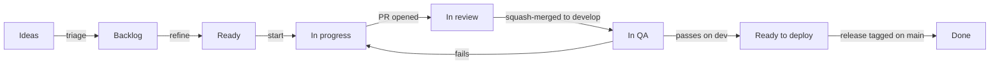

# Branching, ticket lifecycle and release

How a ticket moves from an idea to production, how code moves between branches, and how we ship and hotfix. The team's delivery commands follow this document; if the two disagree, this document wins and the command is fixed.

## 1. The parallel rule

There is no cap on tickets in flight. Every ticket in the current sprint sits in Ready, and any of them may start as soon as it is free: no unresolved blocker, no overlap with a ticket already in flight, and nobody else building it. A ticket is in flight from **In progress** until **Ready to deploy**. The product manager orders the sprint by dependency; the build step refuses only a ticket that is blocked or overlaps one in flight.

Two tickets may run together only when all of this holds:

- their Areas differ, or their "Where it lands" parts of the product do not intersect;
- neither blocks the other;
- they do not both change a migration chain, the lockfile, the OpenAPI contract or shared config.

Each ticket has its own branch. The ticket being built is checked out in the owner's checkout, so the owner sees the changes in the editor and can work on them too; any other ticket in flight uses its own git worktree (`../lm-<n>`), so two tickets never share a working tree. A switch needs a clean tree, and the checkout goes back to `develop` after the merge.

If a ticket in flight turns out to depend on another one, the build step marks the ticket on the current branch as blocked by it and sends it back to Ready (section 2, Blocked). The blocker is ordered first.

An owner-run ticket with no repository code (an account, a recording, a vendor request), labelled `owner-task`, is handed to the owner, needs no branch or worktree and blocks nothing it isn't named as a blocker of.

Why: what limits parallel work is dependencies, overlap and the owner's approvals on sensitive PRs, not a count. Free tickets never wait for each other.



## 2. Board columns

Board: org project #6, "GaugePrep Delivery", in the `Frank-Tech-Org` organisation; repository `Frank-Tech-Org/GaugePrep`. Both were renamed on 2026-11-04 with the product (D-10); the old names redirect.

| Column | Meaning | Where the code is | Leaves when |
|---|---|---|---|
| **Ideas** | Raw, untriaged ticket or suggestion | Nothing | Accepted into the backlog, or closed as duplicate or won't do |
| **Backlog** | Accepted: type, area, priority and milestone set, not yet refined | Nothing | Refined |
| **Ready** | Meets the Definition of Ready below | Nothing | Picked as the next ticket |
| **In progress** | Being built (in flight) | `feature/<n>-<slug>` | PR opened into `develop` |
| **In review** | PR open (in flight) | PR into `develop` | Approved and squash-merged |
| **In QA** | Merged, deployed to dev (in flight) | `develop`, dev | QA passes, or fails back to In progress |
| **Ready to deploy** | Passed QA; no longer in flight | `develop`, then `stage` and staging once promoted | Included in a tagged release |
| **Done** | Live, tagged, "Released in" posted, issue closed | `main` | n/a |

- **Epic.** Spans more than one sprint and groups three or more tickets as sub-issues. Every other ticket has an Epic parent.
- **Spike.** A question answered in one day at most; the result is a finding on the ticket and, if needed, new tickets.
- **Definition of Ready.** Type, Area, Priority, Milestone and Effort set; Epic parent attached; acceptance criteria, Definition of Done, where it lands and dependencies written; two days or less.
- **Blocked.** A blocked ticket goes back to Ready with a GitHub "blocked by" link to its blocker. The link is the record and the `blocked` label only shows it. A blocker counts as resolved once it is Ready to deploy, Done or closed; the board helper's sweep then drops the label, as it does on any closed ticket. A wait outside the team (a provider, a signed form, an owner decision) gets a Chore to link to.

## 3. Branches and environments

Three long-lived branches, each deployed to its own environment. Code only moves forward: `develop` to `stage` to `main`. A hotfix is the one change that starts on `main`, and it is merged back.

| Branch | Purpose | Merged into it by | Deployed to |
|---|---|---|---|
| `main` | Production. Every commit on it is a tagged release. | Owner, merge commit, from `stage` or `hotfix/*` | Production (on a version tag) |
| `stage` | The release candidate: what is about to ship. | Owner, merge commit, from `develop` (promotion) or `main` (hotfix back-merge) | Staging (on push) |
| `develop` | Integration branch and the repository default. Holds QA-passed work plus the tickets in QA. | The merge script, squash, from `feature/*` or `chore/*` (the owner for PRs that touch the guard hook, settings, CI workflows, the git hooks or any helper script); owner, merge commit, from `main` after a hotfix | Dev (on push) |
| `feature/<n>-<slug>` | One ticket of any type except a production hotfix | none | none |
| `chore/<slug>` | Repository and workflow housekeeping, and the changelog commit of a release | none | none |
| `hotfix/<version>-<slug>` | Urgent production fix, branched from `main` | none | Staging (manual run) |

Short-lived branches are deleted after merging. Promotions use merge commits, never squash, so `stage` and `main` keep the same commits as `develop` and never drift.

| Environment | Runs | For | Data and keys |
|---|---|---|---|
| Local | The owner's checkout or a ticket's worktree, Docker Compose | Building and the checks before a PR | Seed data, local open models, test keys |
| CI | Every PR, thrown away after | Tests and security scans | None |
| Dev | `develop`, the shared dev and staging server, own Neon branch, Doppler `gaugeprep/dev` | QA of each ticket | Synthetic seed data; fake SMS, self-hosted open models for AI and speech, test payment keys |
| Staging | `stage`, the same server as a separate deploy, own Neon branch, Doppler `gaugeprep/stg` | Release gate (attack tests, load test, 3G checks), regression and the Friday demo | Synthetic seed data; free or test-mode providers, self-hosted open models for AI and speech, no paid service |
| Production | `main` at a tag, Hetzner | Learners | Real data, live keys |

Why `stage` exists: the Friday demo and the release gate need a version that doesn't change while agents keep merging into `develop`. It replaces the `release/*` branches; a fix found on staging is made on `develop` and promoted again, so nothing is cherry-picked or back-merged after a normal release.

## 4. Versioning

[Semantic Versioning](https://semver.org/): `MAJOR.MINOR.PATCH`, tagged on `main` with an annotated tag such as `v0.3.0`.

| Bump | When | Comes from |
|---|---|---|
| MINOR | New capability (any release with a feature) | `stage` |
| PATCH | Fixes only | `hotfix/*`, or a release from `stage` with only fixes |
| MAJOR | Breaking API change (`/api/v2`) or a non-reversible migration | `stage` |

Versions stay at `0.x.y` until the PRD's release 1 goes live, which is tagged `v1.0.0`.

## 5. Names, commits and PRs

```
feature/<issue>-<short-slug>        feature/7-django-skeleton
chore/release-<version>             chore/release-0.2.0
hotfix/<version>-<short-slug>       hotfix/0.2.1-fix-timer-drift
```

- **Commit and PR titles** follow Conventional Commits, as commitlint enforces: `feat(api): add the health endpoint`. The squash merge keeps the PR title as the commit subject.
- **Linking.** The ticket's branch is created from the ticket (`gh issue develop <n> --name feature/<n>-<slug>`), so the branch and its PR show in the ticket's Development panel. The PR body also says `Refs #<n>`, never `Closes #<n>`. A PR linked this way closes the issue when it merges into `develop`, the default branch, so the board's Status, not open or closed, says where a ticket is. A failed QA reopens it, and the release posts "Released in" on every shipped ticket.
- **No repository change, no PR.** A ticket that writes nothing into the repository (an owner task, research, a decision recorded only on the ticket) has no branch and no PR; its result goes on the ticket.
- **Traceability.** `merge.sh` writes the PR body's `Refs #<n>` lines into the squash commit, so `git log --grep "#<n>"` finds every change of a ticket, including its fix PRs.
- The builder commits to the ticket's branch, pushes it and opens the PR. The merge step merges reviewed PRs into `develop`; only the owner merges into `stage` and `main`, pushes tags and publishes releases. Nobody pushes straight to `main`, `stage` or `develop`.

## 6. Ticket workflow

Delivery runs through build, review, push, merge and QA without stopping until something only the owner can do (a merge into `stage` or `main`, a tag, an account, money, an owner ruling) or a blocker.

1. **Triage and refine.** New tickets land in Ideas. Planning brings each one to the Definition of Ready (section 2), splits anything over two days, and moves it to Ready. The owner closes duplicates and rejected ideas.
2. **Plan the sprint.** Ready tickets go into the two-week Sprint iteration in dependency order. Sprints sit inside the product milestones (M0 to M8).
3. **Pick.** The product manager names every ticket that is free to start: blockers first, then milestone, priority and size, skipping any that would conflict with one in flight.
4. **Build.** The ticket moves to In progress and `feature/<n>-<slug>` is created from the ticket, off an up-to-date `develop`, in the owner's checkout (or its own worktree when that holds another ticket in flight). Nothing is pushed yet.
5. **Review, then one push.** Before the first push, `pnpm check` and the local mechanical checks run, and the reviewers read the local diff in a clean context, then post their verdict as a PR comment once the PR exists. Fixes are commits on the same branch, up to three review rounds; after that the ticket is blocked with what was tried. On `PASS` the branch is pushed once and the PR opened ready for review, not as a draft, because a draft runs CI as well (tested on PR #234). The ticket moves to In review.
6. **Merge.** When the verdict ending `REVIEW: PASS <head sha>` names the PR's head and CI is green, the merge script squash-merges into `develop` and deletes the branch, and refuses unless the base is `develop`, the branch is `feature/*` or `chore/*`, every check is green, and the latest `REVIEW: PASS` names the PR's head sha. A PR that touches authentication, payments, personal data, migrations, append-only tables, scoring formulas or owner-only files needs the owner's approval of that same sha as well, a sign-off and not a second review; a push after the approval makes it stale. A PR that touches owner-only files is merged by the owner. The owner can still merge any PR by hand.
7. **QA.** Dev deploys from `develop`. After the merge, QA moves the ticket to In QA and checks every acceptance criterion on dev. A pass moves it to Ready to deploy. A fail sends it back to In progress with the defects listed and reopens the issue if its merge closed it; the fix goes on `feature/<n>-<slug>-fix`, created from the ticket with `gh issue develop`, in a new PR that references the same ticket.

Until dev exists (M0 ticket #11), QA runs against a local build of `develop`, and the QA report says so.

## 7. Release workflow

**When to release.** A release is due when any of these holds, and planning says so:

- a key feature of release 1 is complete: every ticket that serves it is Ready to deploy (MINOR);
- the end of a sprint, with fixes Ready to deploy and no feature complete (PATCH);
- M0 is complete: the first release, `v0.1.0`, proves the pipeline end to end before any feature ships.

A hotfix never waits (section 8). Ready to deploy tickets that belong to an unfinished feature ship with the next release; a screen a learner could reach half-built stays unlinked until its feature is complete.

**Which version.** The last tag plus one: MINOR if any released ticket is a Story or Task that adds a capability, else PATCH (section 4). A version given by the owner overrides it.

The release manager (the platform engineer) prepares every step and can run the gate alone; the owner presses the two buttons: promote to staging and ship to production.

1. Confirm no ticket is In QA, so `develop` holds only QA-passed work, and list the Ready to deploy tickets. Tickets in progress or review may continue; they are not on `develop` yet. A ticket that failed QA has code on `develop` but is back In progress: wait for its fix, or revert its squash commits (`git log --grep "#<n>"`) on a `chore/revert-<n>` PR before promoting. The ticket returns to Ready, and its work comes back in a new PR. Never cherry-pick a subset of `develop` into `stage`: migrations and the generated API client depend on the commits before them.
2. The release manager commits the `CHANGELOG.md` entry on `chore/release-<version>`, merged into `develop` like any reviewed PR.
3. The release manager opens the promotion PR from `develop` into `stage`. A promotion carries the same tree as the tested `develop` tip, so one cheap check proves the head tree equals a `develop` commit with a green `ci` run instead of running the code again; a hotfix branch still runs the full CI because its code is new. The owner merges the PR with a **merge commit**. Staging deploys after the same identity check, which fails closed.
4. On staging, run the gate (security pass and attack test, dependency audit, performance audit with the load run, claim verification, UX check on changed screens) and QA's regression. A failure is fixed by a ticket on `develop`, then promoted again from step 3.
5. The release manager opens the release PR from `stage` into `main` using the release PR template. The content marketer writes the French and English release notes, starting from GitHub's generated notes (`gh api repos/Frank-Tech-Org/GaugePrep/releases/generate-notes -f tag_name=v<version> -f target_commitish=stage -f previous_tag_name=<last tag>`, which creates nothing) and rewriting them in learner terms. The owner merges the release PR with a **merge commit**.
6. The owner tags and publishes:
   ```bash
   git switch main && git pull
   git tag -a v0.2.0 -m "Release v0.2.0"
   git push origin v0.2.0
   gh release create v0.2.0 --notes-file release-notes.md
   ```
   The tag triggers the production deploy (M0 ticket #13).
7. The release manager moves the included tickets to Done, posts "Released in" on each and closes any still open. No back-merge is needed: everything on `main` came from `develop`.

## 8. Hotfix workflow

For an urgent production bug: a Bug ticket with priority Urgent and the `hotfix` label. A checkpoint goes on each ticket in flight before the fix starts.

1. Branch from `main`, never from `develop` or `stage`, so unreleased work cannot reach production:
   ```bash
   gh issue develop <n> -R Frank-Tech-Org/GaugePrep --base main --name hotfix/0.2.1-fix-timer-drift
   git fetch origin hotfix/0.2.1-fix-timer-drift
   git switch hotfix/0.2.1-fix-timer-drift
   ```
2. The agents fix, test, commit, push and open a PR into `main`. Run the staging deploy workflow on the hotfix branch and QA it there.
3. The owner merges with a merge commit, tags `v0.2.1`, pushes the tag and creates the GitHub release.
4. Back-merge `main` into `stage`, then into `develop`, through PRs the release manager opens and the owner merges with merge commits. Skipping this brings the bug back in the next release. The next push to `stage` redeploys staging from `stage`.
5. Move the ticket to Done, then resume the interrupted ticket from its checkpoint.

## 9. Branch protection

| Branch | Target rules |
|---|---|
| `main` | PR required, CI green, no direct pushes, only PRs from `stage` and `hotfix/*` |
| `stage` | PR required, CI green, no direct pushes, only PRs from `develop` and `main` |
| `develop` | PR required, CI green, a `REVIEW: PASS` for the head commit, the owner's approval for sensitive PRs, squash merge only (merge commit for a back-merge from `main`); the develop alarm checks it after the fact |

GitHub doesn't enforce these on the free plan for a private organisation repository: the API returns 403, and we stay on the free plan. The protection is built from parts:

- The automation account is held by a deny list and a guard on the machine that runs it: no raw push, `gh pr merge`, tag, release, `--amend` or `reset --hard`. It pushes and merges only through the push and merge scripts. How the guard works and its accepted gaps: `docs/runbooks/automation-account.md`.
- A write-access account can still change `main` or `stage`. A workflow on every push to `main` alerts the owner when the commit did not come from an allowed PR. The production deploy runs only from a tag, and the workflow checks that the owner pushed it, so a bad change on `main` cannot reach users.
- A second workflow, the develop alarm, does the same for `develop` and `stage`. A push opens an issue assigned to the owner unless the commit is the merge commit of a merged PR. Allowed into `develop`: from `feature/*` or `chore/*`, merged by the owner or carrying the owner's approval of the PR's last commit (what the merge script requires), and from `main`, merged by the owner. Allowed into `stage`: from `develop` or `main`, merged by the owner. A forced push, a deleted branch, and any commit that changes a workflow file without the owner's merge always raise it. `[skip ci]` can skip the push run, so a scheduled run every hour rechecks the last two hours of pushes (taken from GitHub's push log, not commit dates) and scheduled runs ignore `[skip ci]`. It opens one issue per commit, even if the issue was closed. To prove it fires, run it by hand with a commit that is not a merged PR: `gh workflow run develop-alarm.yml -f branch=develop -f sha=<commit>`. The automation account's token lacks the workflow scope, so GitHub refuses a push that edits or deletes the alarm file. It detects; it does not block.
- Two accounts, both organisation owners. The automation runs as `KefouegFrank`, the owner's main account, so the commits count on it. The owner approves as `frankkefoueg`, the only account used for `stage`, `main`, tags and releases. GitHub won't let the account that opened a PR approve it, so the approval on a `develop` PR always comes from the other account, and the merge script checks it.
- Files that control these limits (the guard and other hooks, the tool settings, the push, merge, board and env scripts, the git hooks and the workflows) change only by the owner's hand. A needed change is staged with one apply script that copies the files and shows the diff, and the merge script refuses a PR that touches them, so the owner merges it.

## 10. Checklists

**Before opening a PR**
- [ ] Branch is `feature/<n>-<slug>` created from the ticket off current `develop` (or `hotfix/*` off `main`), so it shows in the ticket's Development panel
- [ ] PR title follows Conventional Commits; body says `Refs #<n>`
- [ ] Tests and checks pass locally
- [ ] The code review (and any specialist review) passed the local diff before the first push
- [ ] Every acceptance criterion addressed, or listed as a follow-up
- [ ] The Definition of Done items in the ticket are ticked

**Cutting a release**
- [ ] Nothing In QA; Ready to deploy list confirmed; any failed-QA ticket on `develop` fixed or reverted
- [ ] Changelog merged into `develop`; `develop` promoted to `stage` with a merge commit
- [ ] Gate passed on staging: security, dependencies, performance, claims, UX; regression QA passed
- [ ] `stage` merged to `main` with a merge commit, tagged, GitHub release created
- [ ] Tickets moved to Done and closed

**Hotfix**
- [ ] Branched from `main`; QA passed on staging
- [ ] Tagged with a PATCH version
- [ ] `main` merged back into `stage`, then `develop`
- [ ] Interrupted ticket resumed

## 11. Troubleshooting

**QA fails after the merge.** The ticket goes back to In progress and stays in flight. Fix it on a new branch from `develop`, with `Refs #<n>` in the PR. If the ticket is abandoned, or a release can't wait for the fix, revert its squash commits on `develop` before the next promotion (section 7, step 1), so `develop` stays releasable.

**One ticket, several PRs.** Normal: a fix PR or a split ticket. Each squash commit carries `Refs #<n>`, so `git log --grep "#<n>"` lists them all; a revert takes all of them, newest first.

**Reverts keep happening.** If tickets are often held back at release, ship unfinished work behind a feature switch that is off on staging and production, instead of reverting. Until then, a screen a learner could reach half-built stays unlinked (section 7).

**A defect found on staging.** Never fix it on `stage`. Fix it on `develop` through a ticket, then promote again.

**A bad change reached `main`.** Revert it instead of rewriting history (`git revert -m 1 <merge-sha>` for a merge commit), then ship a PATCH release.

**A hotfix wasn't back-merged.** Merge `main` into `stage`, then into `develop`, as soon as it's noticed. Git skips the changes that are already there.
